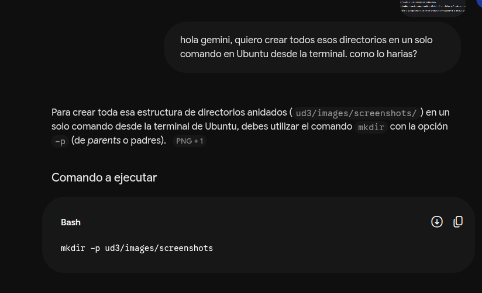
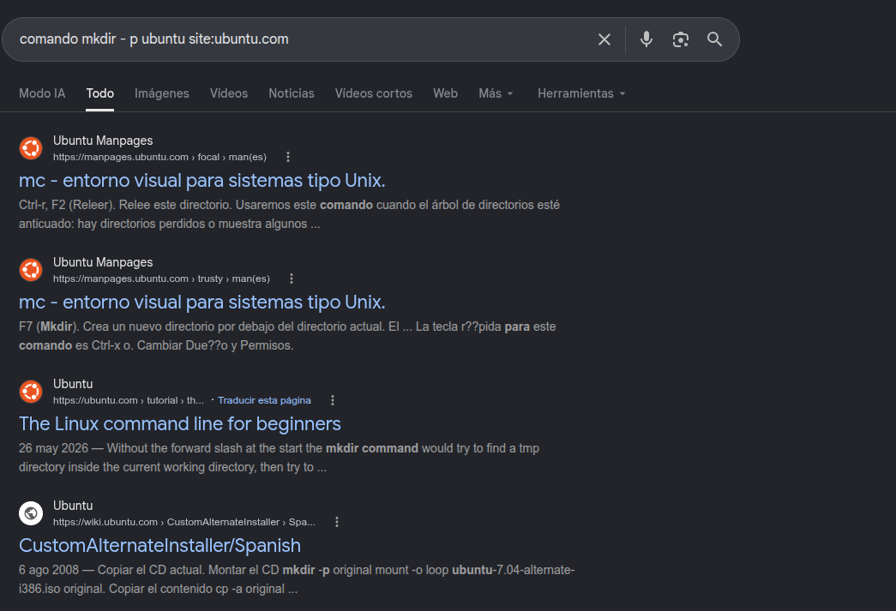
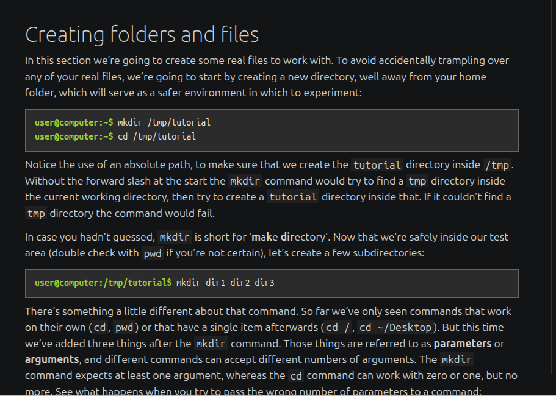
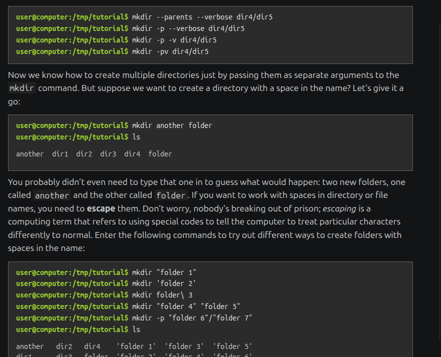
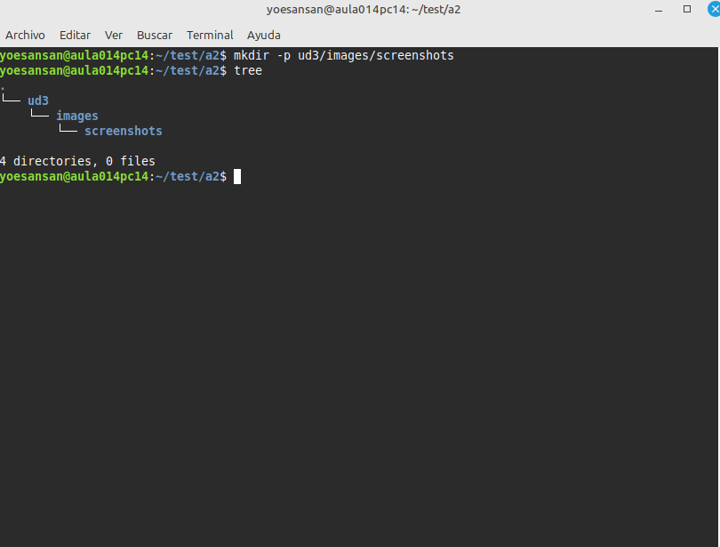

# Actividad 2 
## Busqueda de documentación
## 1.
Lo primero que vamos a hacer es hablar con la Inteligencia Artificial para que nos guie mas o menos que tenemos que hacer, que nos recomienda él y demas.

Hecho esto y visto que la Inteligencia Artificial nos da ya la solucion lo que hay que hacer es asegurarnos de que es real y que no se lo esta inventando. Asi que iremos directamente ha las paginas oficiales para corroborarlo.

## 2.

Con esta busqueda nos aseguramos que todas las webs que nos van a salir son de Ubuntu (oficiales) con el comando "site:". Y luego especificarle que el comando que necesito investigar es "mkdir -p", que es el que me indica Gemini.

## 3. 

 
Tenemos que ir buscando hasta que encontremos esta zona donde dice "Creating folders and files" que en español es "Creando carpetas y archivos". Nosotros estamos intentando crear varias carpetas a la vez asi que seguro que aqui encontramos algo.

## 4.

Aqui lo hemos encontrado, siguiendo un poco para abajo en la misma pagina web hemos encontrado el comando que nos afirmaba que lo que nos decia la Inteligencia Artificial estaba bien. Ahora simplemente lo haremos en nuestra Terminal.

## 5. 

Aqui tenemos el resultado. Ponemos nuestro comando "mkdir -p" para crear varias carpetas a la vez despues ponemos "ud3/images/screenshots" que son las carpetas que queremos crear. Despues de eso para confirmar que se han creado una dentro de otra ponemos el comando "tree" que nos saca la estructura en modo arbol para que nos sea mas facil verlo

