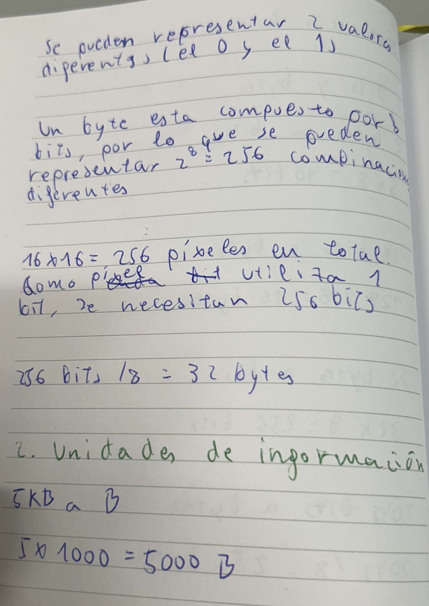
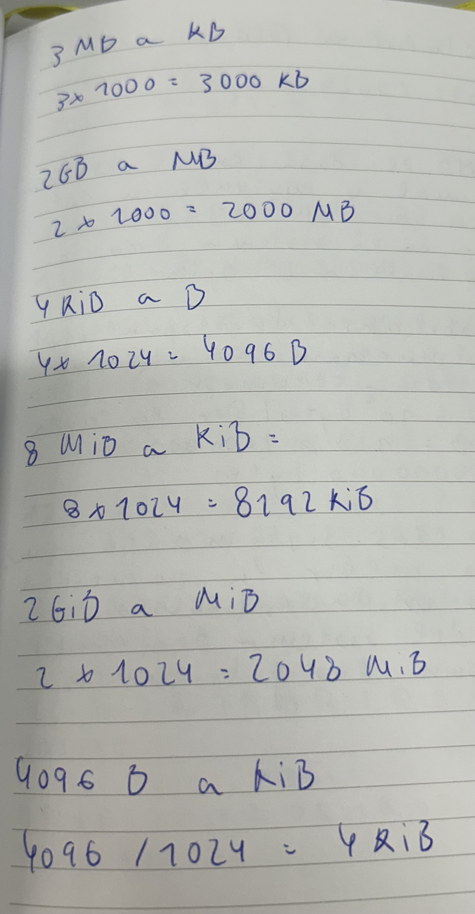
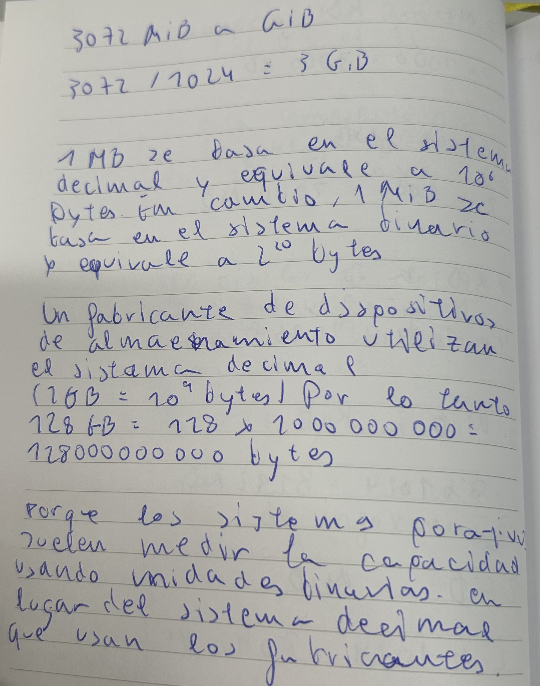
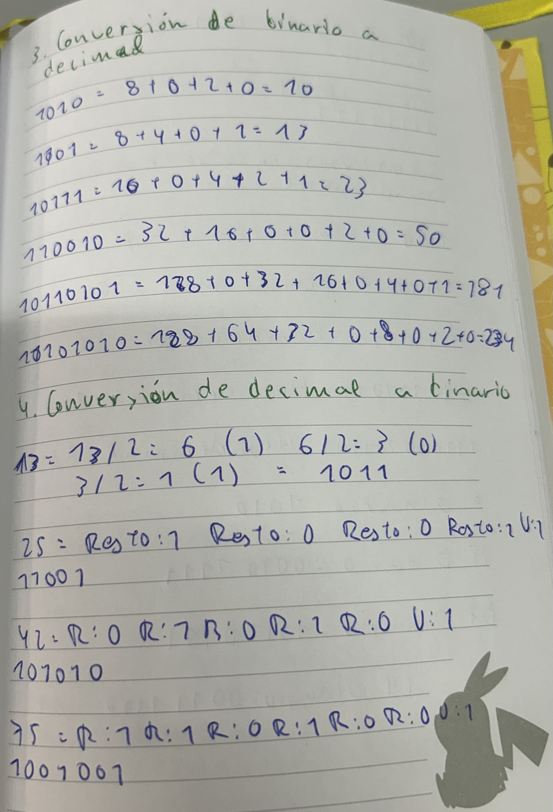
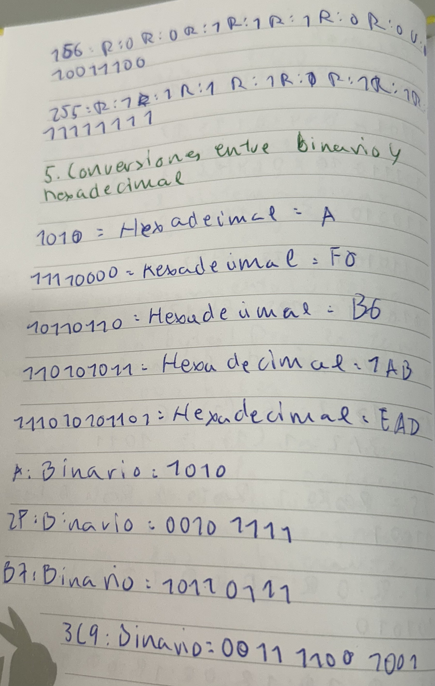
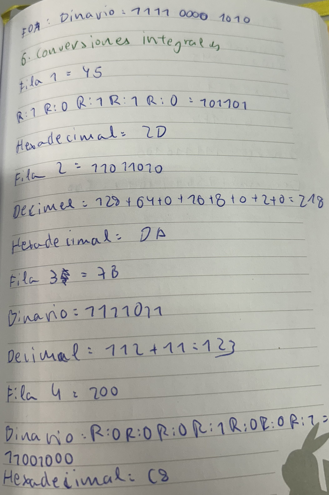
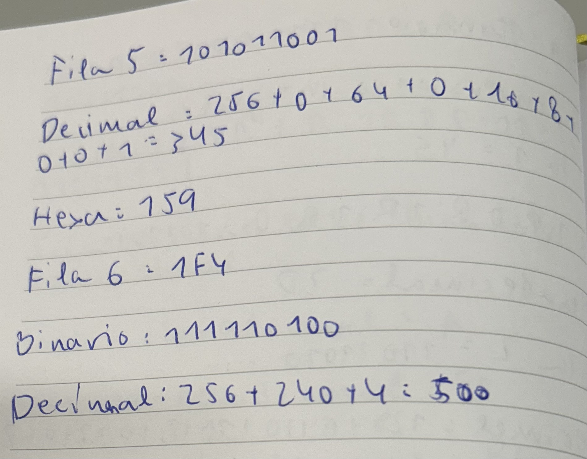

# ACTIVIDAD 2

## 1. Bits y Bytes

## 2. Unidades de informacion 

## 3. Conversion de binario a decimal

## 4. Conversion de decimal a binario

## 5. Conversiones entre binario y hexadecimal

## 6. Conversiones integradas

